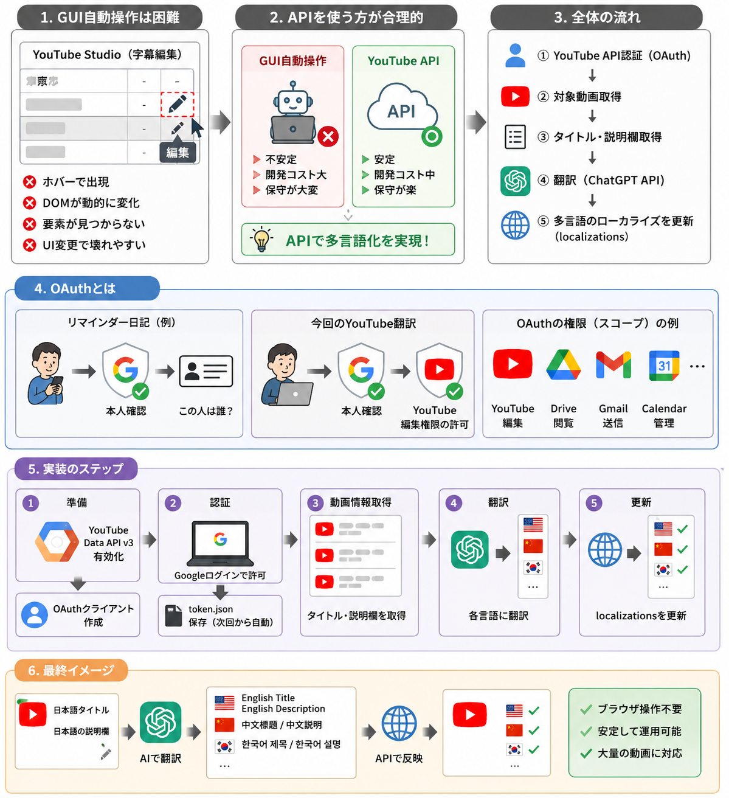

# BGM動画 自動化パイプライン

YouTubeのBGMチャンネル「ゆる朝カフェのすみっこ」の制作・投稿を自動化したツール群です。

手描きイラストの作画キャプチャ（20〜30分）を入力すると、**1時間超のBGM動画を作り、YouTubeに16言語対応でアップロードし、公開予約と同時刻のX投稿までを一度のコマンドで完了**させます。

```bash
python pipeline.py フレンチトースト 043
```

これだけで、編集・BGM合成・サムネ設定・公開予約・再生リスト追加・16言語翻訳が終わります。

---

## 何が自動化されているか

| # | 工程 | 内容 |
|---|---|---|
| 1 | 映像編集 | 余白の自動検出クロップ → 静止区間カット → 1920x1080/30fpsに正規化 |
| 2 | 尺の決定 | 映像ループの切れ目で終わるよう、本編尺をループ長の整数倍に切り上げ |
| 3 | BGM合成 | 90曲のライブラリからランダム選曲し、尺ぴったりに連結＋末尾12秒フェードアウト |
| 4 | レンダリング | オープニング（9.73秒）を先頭に連結して書き出し |
| 5 | 文章生成 | gpt-4oで日本語タイトル・概要欄を生成（実尺から「1時間ちょっと」等の表記を自動選択） |
| 6 | アップロード | YouTube Data API v3でアップロード、サムネ設定、再生リスト追加 |
| 7 | 公開予約 | 1日1本になるよう、既存の投稿日を見て翌朝7:00 JSTに予約 |
| 8 | 多言語化 | 15言語に翻訳してlocalizationsに登録（日本語と合わせて16言語） |
| 9 | X投稿 | 公開と同時刻（翌朝7:00）にサムネ画像付きで自動投稿 |

---

## 技術的に工夫した点

### 1. 静止区間の自動カット（尺を40%圧縮）

作画キャプチャには、ペンが止まっている時間が大量に含まれます。`freezedetect` では「ペン先の狭い範囲しか動かないフレーム」を全編フリーズと誤判定したため、**`mpdecimate` で直前フレームとほぼ同一のフレームを落とし、`setpts` でタイムスタンプを詰め直す**方式に切り替えました。

```python
norm_vf = (crop_str + ",scale=1920:1080:flags=lanczos,"
           f"mpdecimate={DECIMATE_OPT},setpts=N/FRAME_RATE/TB,fps=30")
```

実測の圧縮率:

| 動画 | 元の尺 | カット後 | 削減率 |
|---|---|---|---|
| 041 クロワッサン | 1633.2秒 | 1009.8秒 | 38% |
| 042 ココナッツ | 1699.1秒 | 963.3秒 | 43% |
| 043 フレンチトースト | 1156.2秒 | 692.4秒 | 40% |

感度（`hi` / `lo` / `frac`）は3段階で測って、描画を削らない値を選んでいます。

### 2. 映像ループの切れ目で終わる尺決定

当初は「1時間きっかり」で切っていたため、映像が中途半端な位置で終わっていました。現在は**1時間を超えた直後のループ境界**を終了点にしています。

```python
loop_len = get_duration(tmp_edited)
loops    = math.ceil(MIN_BODY_SEC / loop_len)
body_sec = loop_len * loops
```

BGMもこの `body_sec` に合わせて生成するため、映像も音楽も途中で切れません。尺は1時間〜2時間超で可変になります。

### 3. 実尺に合わせた尺表記の自動生成

尺が可変になったので、タイトルの「1時間」固定表記が実尺とズレるようになりました。実尺から表記を決め、**切り上げない**（実際より長く言わない）方針にしています。

| 端数 | 日本語 | 英語 |
|---|---|---|
| 0〜19分 | 1時間ちょっと | a little over 1 hour |
| 20〜49分 | 1時間半 | about an hour and a half |
| 50分以上 | 1時間56分 | about 1 hour 56 minutes |

英語表記は翻訳プロンプトに `DURATION NOTE` として添え、各言語で自然な言い方に適応させます（`Just Over an Hour` / `한 시간 조금 넘는 여유` / `un peu plus d'une heure` など）。

### 4. 1日1本に保つ公開予約ロジック

チャンネルの最新投稿日をAPIで取得し、重複しない最短の朝7:00を選びます。

- 0:00〜6:59にアップロード → 当日の7:00
- 7:00〜23:59にアップロード → 翌日の7:00
- すでにその日に投稿がある場合は1日ずつ後ろにずらす

### 5. ローカライズ登録の堅牢化

`videos.update` は16言語を1リクエストで送るため、**1言語でも不正だと全言語が `400 invalidVideoMetadata` で失敗**します。実際に043で発生しました。

対策として、
- `<` `>` の置換とタイトル100文字・概要欄5000文字での切り詰め（`sanitize_meta()`）
- バッチが弾かれたら1言語ずつ入れ直し、通る言語は登録して**弾かれた言語名をログに残す**

を入れています。これで全滅せず、原因言語が特定できます。

### 6. BGM選曲ログ

どの曲が何分から流れているかをテキストに残します。曲調が合わない曲を見つけたら、その動画だけ再編集できます。

```
開始       終了       曲名
0:00:00    0:03:50    Saxophone Rain 2.mp3
0:03:50    0:06:51    Copper Staircase 2.mp3
...
```

ログの正確さは、RMSエンベロープの相互相関による音声照合で6箇所を検証済みです（一致率0.99以上）。

---

### 7. GUI自動操作からAPIへの切り替え

多言語化は当初YouTube Studioの画面操作で試みましたが、ホバーでしか出ないボタン・動的に変わるDOM・UI変更での破損があり、YouTube Data API v3に切り替えました。設計時にまとめた図解を `YT_translate_by_api_oauth.png` に残しています。



---

## 技術スタック

| 分野 | 使用技術 |
|---|---|
| 動画・音声処理 | ffmpeg / ffprobe（`cropdetect`, `mpdecimate`, `setpts`, `concat`, `afade`, `volumedetect`, `signalstats`） |
| 言語 | Python 3.14 |
| 生成・翻訳 | OpenAI API（gpt-4o） |
| 動画投稿 | YouTube Data API v3（`videos.insert` / `thumbnails.set` / `playlistItems.insert` / `localizations`） |
| 認証 | Google OAuth 2.0（`google-auth-oauthlib`、トークン自動リフレッシュ） |
| SNS投稿 | X API v2 + tweepy（OAuth 1.0a、画像は v1.1 `media_upload`） |
| スケジューリング | Windows Task Scheduler（`-StartWhenAvailable -WakeToRun`） |
| 検証 | NumPy（音声フィンガープリントによるBGMログの照合） |

---

## ファイル構成

```
.
├── pipeline.py              メイン処理（全9工程）
├── x_post.py                X投稿のライブラリ
├── post_0XX.py              Task Scheduler用のワンショット投稿スクリプト
├── upload_video.py          アップロード単体
├── translate_multilang.py   既存動画への言語追加
├── translate_all_langs.py   全動画の一括翻訳
├── yt_translate_api.py      翻訳APIの実装（初期版）
├── yt_translate_v2.py       翻訳APIの実装（改良版）
├── retry_failed.py          失敗分のリトライ
├── debug_one.py             1本だけ試すデバッグ用
├── BGMログ/                 各動画の選曲タイムテーブル
├── 素材/オープニング.mp4     全動画の冒頭に付く共通オープニング
├── handover.md              設計・引き継ぎドキュメント
├── session_memo.md          開発経緯のメモ
└── .env.example             必要な環境変数の雛形
```

---

## セットアップ

```bash
pip install openai google-api-python-client google-auth-oauthlib python-dotenv tweepy numpy
```

ffmpeg / ffprobe をPATHに通しておきます。

認証情報は `.claude/` に置きます（すべて `.gitignore` で除外済み）。

| ファイル | 内容 |
|---|---|
| `.claude/.env` | OpenAI・XのAPIキー（`.env.example` 参照） |
| `.claude/client_secret.json` | Google Cloud ConsoleのOAuthクライアント |
| `.claude/token.json` | 初回認証時に自動生成 |

スクリプトの基準ディレクトリは `BGM_BASE_DIR` 環境変数、未設定ならスクリプト自身の置き場所になります。

---

## 使い方

```bash
# 新しい動画を作ってアップロードまで
python pipeline.py <食べ物名> [連番]

# X投稿のテスト（即時投稿されるので注意）
python x_post.py <食べ物名> <video_id> <絵文字>
```

入力に必要なもの:

- `メイキング/<食べ物名>.mp4` — 作画キャプチャ
- `メイキング/<食べ物名>.png` — サムネイル画像（**ファイル名は食べ物名と完全一致させる**。ローマ字名だと見つけられません）

---

## リポジトリに含まれないもの

| 対象 | 理由 |
|---|---|
| 完成動画（`*.mp4`） | 1本150〜230MB。GitHubの100MB制限を超えるため |
| BGM音源（`*.mp3` 90本） | 約500MB。suno生成物 |
| メイキング元データ | 作画キャプチャ1本が800MB超 |
| 認証情報 | チャンネルを操作できる資格情報のため |

---

## 実績

2026年11月2日時点で、このパイプラインで **46本**（うち公開済み45本）を制作・投稿しています。
